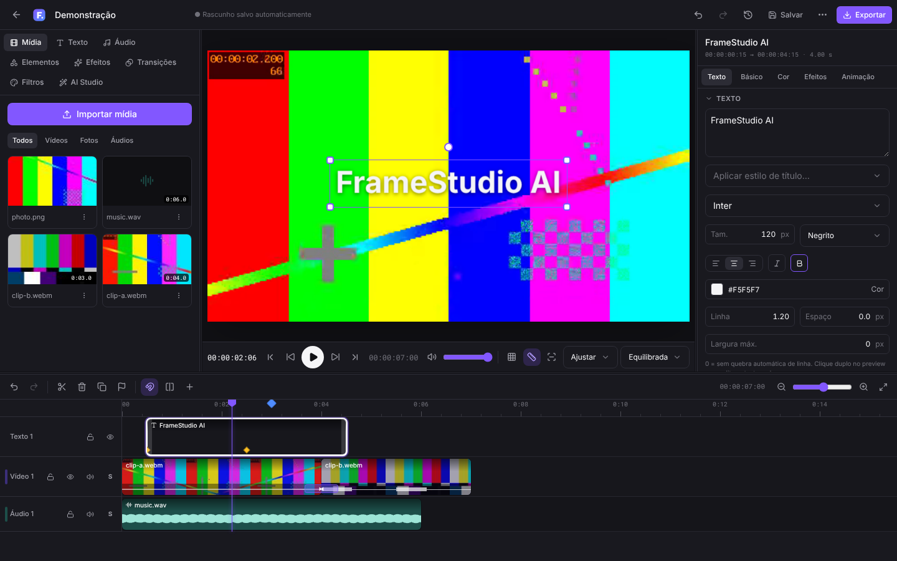
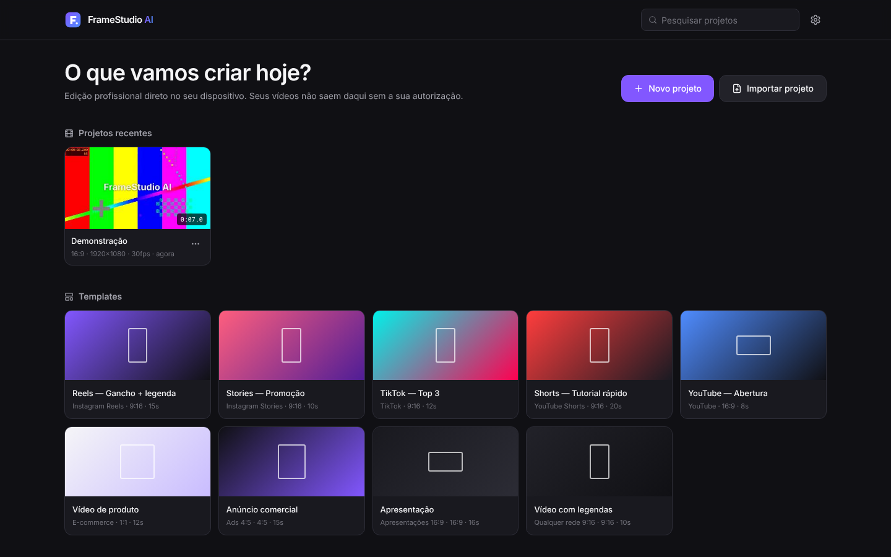
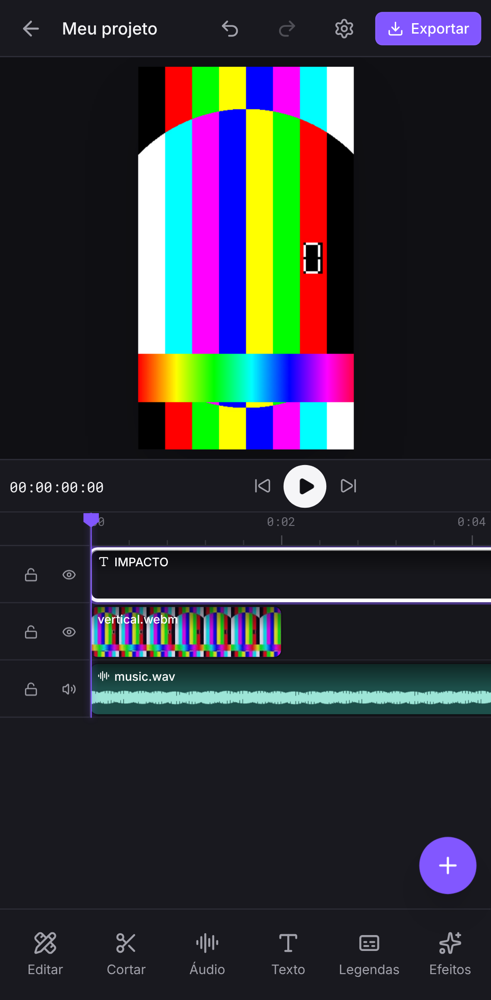

# FrameStudio AI

Editor de vídeo profissional, multiplataforma e com ferramentas de IA — rodando **localmente** no
navegador, como PWA instalável, como app desktop (Tauri) e empacotável para Android/iOS (Capacitor).

> Importar vídeo → visualizar → cortar → adicionar texto → adicionar áudio → salvar projeto →
> exportar um vídeo real. Esse fluxo completo é testado automaticamente a cada execução da suíte
> E2E, e o arquivo exportado é verificado com FFprobe.



| Tela inicial | Mobile |
| --- | --- |
|  |  |

---

## Sumário

1. [Requisitos](#requisitos)
2. [Instalação e execução](#instalação-e-execução)
3. [Como usar](#como-usar)
4. [Exportação](#procedimento-de-exportação)
5. [Testes](#testes)
6. [Desktop e mobile](#desktop-e-mobile)
7. [Estrutura do projeto](#estrutura-do-projeto)
8. [Recursos e limitações](#recursos)
9. [Privacidade](#privacidade-e-segurança)

Documentos complementares: [Arquitetura e análise de compatibilidade](docs/ARCHITECTURE.md) ·
[Progresso por fase](PROGRESS.md) · [Exemplos de projetos](examples/README.md)

## Requisitos

| Ferramenta | Versão | Para quê |
| --- | --- | --- |
| Node.js | 20.19+ (testado com 22) | build, dev server, testes |
| npm | 10+ | gerenciador do monorepo (workspaces) |
| FFmpeg/FFprobe | qualquer recente | **somente** para gerar mídias de teste e verificar exportações nos testes |
| Rust + Cargo | 1.77+ | somente para o app desktop |
| Android Studio / Xcode | — | somente para builds nativos mobile |

Navegadores suportados: Chrome/Edge 110+, Safari 17+, Firefox 130+ (veja a
[matriz de compatibilidade](docs/ARCHITECTURE.md#análise-de-compatibilidade)).

## Instalação e execução

```bash
cd framestudio-ai
npm install          # instala todos os pacotes do monorepo
npm run dev          # http://localhost:5173 (modo desenvolvimento)
```

Build de produção e servidor local:

```bash
npm run build        # gera apps/web/dist (PWA)
npm run preview      # http://localhost:4173
```

> Em ambientes sem acesso à rede para binários nativos opcionais, use `npm install --ignore-scripts`
> (o pacote `onnxruntime-node`, dependência transitiva do transformers.js, não é usado no navegador).

Scripts úteis na raiz:

| Script | Descrição |
| --- | --- |
| `npm run dev` | servidor de desenvolvimento do app web |
| `npm run build` / `npm run preview` | build de produção / servidor de produção |
| `npm run typecheck` | TypeScript estrito em todos os pacotes, app e testes |
| `npm test` | testes unitários (Vitest) |
| `npm run test:e2e` | testes ponta a ponta (Playwright, inclui exportação real) |
| `npm run fixtures` | gera as mídias de teste com FFmpeg |
| `npm run desktop:dev` / `npm run desktop:build` | app desktop (Tauri) |
| `npm run mobile:sync` | copia o build web para os projetos Android/iOS |

## Como usar

1. **Novo projeto**: escolha o formato (16:9, 9:16, 1:1, 4:5, 21:9 ou personalizado), resolução,
   FPS e cor de fundo — ou comece por um **template** (Reels, Stories, TikTok, Shorts, YouTube,
   produto, anúncio, apresentação, vídeo com legendas).
2. **Importar mídia**: botão *Importar mídia* ou arraste arquivos para o painel. São lidos
   duração, resolução, FPS, codecs, canais e rotação; miniaturas e formas de onda são geradas.
3. **Montar**: arraste da biblioteca para a timeline (ou clique em **+**). Arraste clipes entre
   faixas, apare pelas bordas, use **S** para dividir no playhead, **Ctrl+Alt+arrastar** para slip.
4. **Texto, elementos, efeitos, transições e filtros**: abas da biblioteca. Transições podem ser
   soltas sobre o corte entre dois clipes encostados.
5. **Propriedades** (painel direito): transformar, opacidade/mistura, recorte, máscara,
   velocidade, cor (curvas, HSL, LUT), efeitos, áudio (fades, EQ, compressor, redução de ruído,
   normalização LUFS) e keyframes (losango ◇ ao lado de cada propriedade).
6. **No preview**: clique para selecionar, arraste para mover, alças para escalar/girar,
   clique duplo para editar textos.
7. **AI Studio**: assistente de comandos (“Corte os primeiros 5 segundos”), legendas
   automáticas, remoção de silêncios, cortes inteligentes, reenquadramento, ducking, sugestões e
   clipes curtos.
8. **Salvar**: Ctrl+S. O autosave guarda um ponto de recuperação continuamente.
9. **Exportar**: botão *Exportar*.

Atalhos principais (configuráveis em ⋯ → Atalhos de teclado):

| Ação | Atalho |
| --- | --- |
| Reproduzir/pausar | Espaço |
| Desfazer / refazer | Ctrl/⌘+Z · Ctrl/⌘+Shift+Z |
| Salvar | Ctrl/⌘+S |
| Copiar / colar / recortar / duplicar | Ctrl/⌘+C · V · X · D |
| Excluir / excluir fechando espaço | Delete · Shift+Delete |
| Dividir no playhead | S |
| Quadro anterior/seguinte | ← / → (Shift: 1 s) |
| Ponto de edição anterior/seguinte | ↑ / ↓ |
| Zoom da timeline | + / − (ou Ctrl+roda) |
| Marcador | M |

## Procedimento de exportação

1. Clique em **Exportar**. O app testa o codificador do dispositivo e mostra **somente** formatos,
   codecs e resoluções suportados (MP4/WebM/MOV · H.264/H.265/VP9/AV1 · 480p–4K · 24–60 fps).
2. Escolha nome, destino (no Chrome/Edge e no app desktop o arquivo é gravado direto no disco;
   nos demais é baixado), qualidade ou bitrate. O tamanho estimado é calculado a partir do
   bitrate real que será usado.
3. Acompanhe o progresso (quadro atual, quadros/s, tempo restante) e cancele quando quiser.
4. Ao terminar, o vídeo pode ser assistido no próprio diálogo.

Cada quadro é renderizado pelo mesmo compositor do preview e codificado via WebCodecs; o áudio é
mixado offline pelo mesmo grafo do preview e multiplexado pelo Mediabunny.

## Testes

```bash
npm test             # 68 testes unitários
npm run fixtures     # gera tests/fixtures/* (requer FFmpeg)
npm run test:e2e     # suíte E2E (build de produção + Chromium)
```

A suíte E2E cobre:

* **Fluxo essencial** completo, com verificação do arquivo por FFprobe (resolução, duração,
  áudio estéreo, decodificação sem erros, quadro não-preto e áudio audível).
* Transições, efeito P&B, cor, keyframes de opacidade e velocidade 2x — verificados nos quadros
  do arquivo exportado.
* Cancelamento da exportação, erros de importação (arquivo corrompido, codec não suportado),
  `.fstudio` empacotado (exportar → excluir → reimportar), undo/redo, reprodução do preview,
  AI Studio (assistente, silêncios, sugestões, consentimento do modelo) e editor mobile.

Mídias de teste (pequenas e reproduzíveis) são geradas por `scripts/make-fixtures.mjs`.

## Desktop e mobile

### PWA (todas as plataformas)

Abra o app no navegador e use *Instalar app* (Chrome/Edge/Android) ou *Adicionar à Tela de Início*
(Safari/iOS). O service worker mantém o app disponível offline.

### Desktop — Tauri 2 (`apps/desktop`)

```bash
# Linux: sudo apt install libwebkit2gtk-4.1-dev build-essential libxdo-dev libssl-dev librsvg2-dev
npm run desktop:dev                 # janela nativa com o servidor de desenvolvimento
npm run desktop:build               # instaladores (.deb/.AppImage, .msi/.exe, .dmg)
```

O app desktop usa o mesmo build web e adiciona o diálogo nativo de salvar arquivos. Permissões
mínimas (`src-tauri/capabilities/default.json`) e CSP restritiva.

### Mobile — Capacitor 8 (`apps/mobile`)

```bash
npm run mobile:sync                  # build web + cópia para android/ e ios/
npm run open:android -w @framestudio/mobile   # abre no Android Studio
npm run open:ios -w @framestudio/mobile       # abre no Xcode (macOS)
```

A interface mobile (preview em destaque, timeline com pinça para zoom, barra de ferramentas inferior
com painéis deslizantes e feedback tátil) é ativada automaticamente em telas pequenas.

## Estrutura do projeto

```
framestudio-ai/
├── apps/
│   ├── web/          app React (interface desktop + mobile + PWA)
│   ├── desktop/      Tauri 2 (src-tauri em Rust)
│   └── mobile/       Capacitor 8 (android/, ios/)
├── packages/
│   ├── shared/           contratos e utilitários
│   ├── timeline/         modelo e operações da timeline
│   ├── editor-core/      operações validadas, histórico, efeitos
│   ├── media-engine/     probe, capacidades, leitura de quadros, miniaturas, proxies
│   ├── audio-engine/     mixagem, LUFS, silêncios, redução de ruído
│   ├── render-engine/    compositor WebGL2/Canvas e exportação
│   ├── ai-engine/        assistente e ferramentas de IA
│   ├── project-storage/  IndexedDB/OPFS, .fstudio, migrações, autosave
│   └── ui/               design system
├── e2e/              testes Playwright
├── tests/fixtures/   mídias geradas para testes
├── scripts/          geração de fixtures, ícones, typecheck
├── examples/         projetos de exemplo (.fstudio)
└── docs/             arquitetura e capturas de tela
```

## Recursos

A lista completa de concluídos e pendentes, por fase, está em **[PROGRESS.md](PROGRESS.md)**.
Resumo das limitações atuais (detalhes em [ARCHITECTURE.md](docs/ARCHITECTURE.md#limitações-conhecidas)):

* Transcrição Whisper implementada (transformers.js), **não validada** neste ambiente de
  desenvolvimento por falta de acesso ao Hugging Face. Funciona com espelho de modelos configurável.
* Remoção de fundo por IA e rampas de velocidade ainda não implementadas.
* Exportação na thread principal; FFmpeg nativo no desktop pendente.
* Builds Android/iOS não compilados aqui (sem SDK); projetos nativos gerados.

## Privacidade e segurança

* Edição 100% local; nenhum vídeo é enviado a servidores.
* Mídia validada por assinatura binária, extensão e limite de tamanho configurável; arquivos
  corrompidos geram mensagens claras.
* `.fstudio` lido com limite de descompactação (proteção contra zip bomb) e validação/migração.
* A IA só propõe operações de uma lista permitida, validadas por simulação e confirmadas pelo
  usuário. Nenhum comando arbitrário é executado.
* Provedor de IA externo é opcional, desligado por padrão, e recebe apenas o texto do comando e um
  resumo do projeto (ou o texto das legendas, ao traduzir).
* Downloads de modelos exigem consentimento explícito, com tamanho e espaço disponível exibidos.
